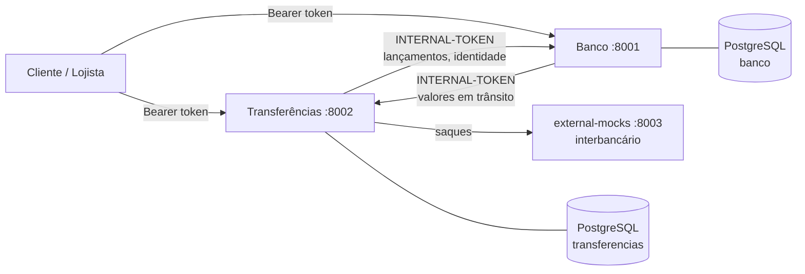

# RNV — Instituição de Pagamento com Conta PJ

Conta digital para empresas com gateway de pagamento: o lojista vende (pix, boleto, cartão), o dinheiro fica retido numa janela de liberação, cai na conta descontada a tarifa, e ele saca para fora quando quiser. **Não oferecemos crédito**: só movimentamos dinheiro de terceiros, sem risco de crédito e sem capital próprio.

Desafio do Bootcamp QI Tech. Monorepo com dois serviços de negócio e um simulador de sistemas externos.

## Destaques

- **Livro-razão de partida dobrada.** Todo movimento é uma `transaction` com `entry` de débito e crédito que fecham em zero. Saldo é derivado (`SUM(credit) - SUM(debit)`), nunca armazenado. Nada é apagado: correção é lançamento novo (estorno, reversão).
- **Dinheiro sem limbo.** Cada centavo está numa conta: `reserves` (o que o banco tem), `in_transit` (recebido na janela ou sacado e ainda não saído), `revenue` (tarifas) ou a conta do cliente. A equação `reserves = in_transit + revenue + clientes` é exposta para auditoria.
- **Idempotência na própria entidade.** `Idempotency-Key` + hash do pedido gravados na linha da operação, com `UNIQUE`. Retry com o mesmo conteúdo devolve o estado atual; conteúdo diferente é recusado.
- **Concorrência sem saldo negativo.** Débito trava a linha da conta (`SELECT ... FOR UPDATE`), soma o saldo depois da trava e só então lança. Estorno e liberação disputam a linha do pagamento: só um vence.
- **Saque com retentativa.** O payout chama o interbancário, retenta com backoff exponencial em caso de timeout e, se falhar de vez, devolve o dinheiro por reversão. Nunca existe saque falho sem estorno.
- **Dinheiro em centavos inteiros.** Sem `float`, sem `round()`. A tarifa arredonda para cima e `tarifa + líquido == valor`, exato. Taxa e janela são snapshotadas na venda: mudar a tarifa nunca altera o que já foi vendido.
- **Serviços isolados.** Um banco de dados por serviço, sem FK nem join entre eles. Comunicação por HTTP síncrono com token interno; entre serviços só trafega UUID.

## Arquitetura



| Serviço | Dono de |
|---|---|
| **Banco** (`banco/`) | clientes, empresas, contas, tokens, livro-razão (`transaction`/`entry`). Valida que os lançamentos fecham e deduplica. |
| **Transferências** (`transferencias/`) | vendas (`payment`), saques (`payout`), tarifas por meio de pagamento, janela de liberação e os jobs de liberação e reconciliação. |
| **external-mocks** (`external-mocks/`) | simulador do interbancário: confirma, recusa, não responde ou falha e depois confirma, conforme o cenário pedido. |

## O caminho do dinheiro

| Evento | Lançamento |
|---|---|
| Venda chega | D `reserves` / C `in_transit` |
| Liberação (fim da janela) | D `in_transit` / C conta do lojista (líquido) + C `revenue` (tarifa) |
| Estorno dentro da janela | D `in_transit` / C `reserves` (valor cheio) |
| Saque pedido | D conta do lojista / C `in_transit` |
| Saque confirmado | D `in_transit` / C `reserves` |
| Saque recusado ou sem resposta | D `in_transit` / C conta do lojista (reversão) |

Uma conta só encerra com saldo zero e nada em trânsito; o Banco consulta o Transferências antes de fechar e, se ele não responder, recusa.

## Rodando

Pré-requisitos: Docker e Python 3.11.

```bash
docker compose up -d                  # sobe APIs, bancos e o mock
python3 -m venv .venv && source .venv/bin/activate
pip install -r requirements-dev.txt
pytest                                # roda as suítes dos três serviços
```

| Serviço | Porta |
|---|---|
| Banco | `8001` |
| Transferências | `8002` |
| external-mocks | `8003` |
| PostgreSQL (banco / transferencias) | `5434` / `5433` |

Os containers são efêmeros: o código vive na imagem (`docker compose up -d` reconstrói ao mudar `src/`) e os bancos ficam em memória, então `docker compose down && docker compose up -d` recomeça do zero. As variáveis de ambiente têm padrão de desenvolvimento; para sobrescrever, copie `.env.example` para `.env`.

## Testes

Desenvolvido em **TDD**: cada rota nasceu de um teste de integração que falhou primeiro. São cerca de 800 testes caixa-preta, que falam com as APIs por HTTP como um cliente de verdade, sem importar código de `src/`. Cobrem o caminho feliz e cada código de erro, além de corrida de débitos simultâneos, dez retries com a mesma chave, estorno disputando a liberação e saque esgotando as tentativas.

| Comando | O que roda |
|---|---|
| `pytest` | tudo, menos os testes de falha de infraestrutura |
| `pytest -m "not fault and not slow"` | pula também os que esperam o timeout real do interbancário (~5 s cada) |
| `docker compose --profile fault up -d` e `pytest -m fault` | Banco fora do ar, Transferências fora do ar, pool de conexões esgotado |

## Stack

Python 3.11 · FastAPI · SQLAlchemy · PostgreSQL · Docker Compose · pytest · JSON Schema para validar a entrada.

Código em camadas com dependência só para dentro: `resource` (HTTP) → `controller` (regra de negócio e commit) → `repository` (consulta) → `model`. Erros com código estável no formato `{title, description, translation, code}` (`RNV000xxx` genéricos, `RNV001xxx` de negócio).

## Documentação

- [Rotas](internal_docs/rotas.md): o contrato de cada endpoint.
- [Catálogo de erros](internal_docs/catalogo-de-erros.md): todos os códigos `RNV`.
- [Mocks externos](internal_docs/mocks-externos.md): o contrato do simulador interbancário.
- [Limites e evolução](internal_docs/limites-e-evolucao.md): o que o projeto não resolve hoje e como evoluiria.

## Time

Ramon Guimarães · Victoria Bertuchi · Natalia Lugão
