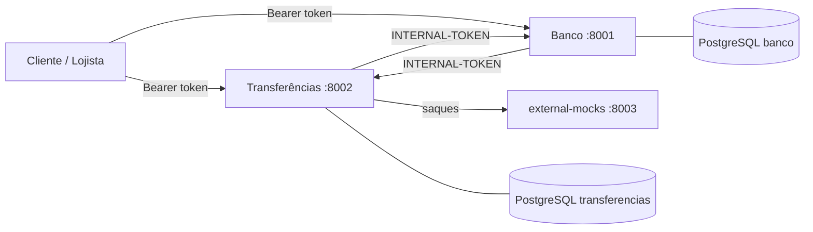

# RNV — Instituição de Pagamento com Conta PJ

Conta digital para empresas com gateway de pagamento: o lojista vende, o dinheiro fica retido numa janela de liberação, cai na conta descontada a tarifa, e ele saca para fora. Não oferecemos crédito. Desafio do Bootcamp QI Tech.

## Arquitetura



| Serviço | Dono de |
|---|---|
| **Banco** (`banco/`) | clientes, empresas, contas, tokens e livro-razão (`transaction`/`entry`) |
| **Transferências** (`transferencias/`) | vendas (`payment`), saques (`payout`), tarifas, janela de liberação e jobs |
| **external-mocks** (`external-mocks/`) | simulador do interbancário |

Um banco de dados por serviço; comunicação por HTTP síncrono com `INTERNAL-TOKEN`.

## Rodando

Pré-requisitos: Docker e Python 3.11.

```bash
docker compose up -d                  # sobe APIs, bancos e o mock
python3 -m venv .venv && source .venv/bin/activate
pip install -r requirements-dev.txt
pytest
```

| Serviço | Porta |
|---|---|
| Banco | `8001` |
| Transferências | `8002` |
| external-mocks | `8003` |
| PostgreSQL (banco / transferencias) | `5434` / `5433` |

Os containers são efêmeros: o código vive na imagem (`docker compose up -d` reconstrói ao mudar `src/`) e os bancos ficam em memória. `docker compose down && docker compose up -d` recomeça do zero. Para sobrescrever as variáveis de ambiente, copie `.env.example` para `.env`.

## Testes

Testes de integração caixa-preta, via HTTP, em TDD.

| Comando | O que roda |
|---|---|
| `pytest` | tudo, menos os testes de falha de infraestrutura |
| `pytest -m "not fault and not slow"` | pula também os que esperam o timeout real do interbancário (~5 s cada) |
| `docker compose --profile fault up -d` e `pytest -m fault` | Banco fora do ar, Transferências fora do ar, pool de conexões esgotado |

## Stack

Python 3.11 · FastAPI · SQLAlchemy · PostgreSQL · Docker Compose · pytest · JSON Schema.

## Documentação

As decisões e o raciocínio do projeto estão na RFC. No repositório:

- [Rotas](internal_docs/rotas.md): o contrato de cada endpoint.
- [Catálogo de erros](internal_docs/catalogo-de-erros.md): todos os códigos `RNV`.
- [Mocks externos](internal_docs/mocks-externos.md): o contrato do simulador interbancário.
- [Limites e evolução](internal_docs/limites-e-evolucao.md): o que o projeto não resolve hoje e como evoluiria.

## Time

Ramon Guimarães · Victoria Bertuchi · Natalia Lugão
