# Modelo de dados

Dois bancos PostgreSQL, um por serviço, gerados por `banco/database/database.sql` e `transferencias/database/database.sql`. Este documento traz **todas** as tabelas e colunas, com tipo, chaves e restrições; a visão resumida e o porquê de cada escolha estão na [RFC](rfc-rnv-v8.0.md). Convenções:

- `id` `SERIAL` é a chave interna: nunca sai na resposta e nunca cruza serviço. A chave pública é um UUID v4 em `CHAR(36)` (`*_key`), a única que trafega entre serviços.
- Dinheiro é `BIGINT` em centavos (`*_minor`). Toda data é `TIMESTAMPTZ`. Toda coluna é `NOT NULL`, salvo as marcadas como "nulo".
- Enumeradores são **tabelas de lookup** (`enumerator` `UNIQUE`, em minúsculo) referenciadas por FK, nunca texto solto nem `ENUM` nativo.
- Tabelas de evento (`*_status_event`) são append-only: guardam cada troca de status com motivo e instante.

## Banco (livro e identidade)

```mermaid
erDiagram
    client ||--|{ api_token : "autentica"
    client ||--o{ company : "e responsavel por"
    company ||--o| account : "tem no maximo uma"
    account_class ||--o{ account : "classifica"
    account_status ||--o{ account : "estado atual"
    account ||--o{ account_status_event : "historico"
    account_status ||--o{ account_status_event : "estado registrado"
    transaction_type ||--o{ transaction : "tipa"
    transaction_status ||--o{ transaction : "estado atual"
    transaction_type ||--o{ allowed_transition : "transicoes do tipo"
    transaction_status ||--o{ allowed_transition : "de / para"
    transaction ||--o{ transaction_status_event : "historico"
    transaction_status ||--o{ transaction_status_event : "estado registrado"
    transaction ||--|{ entry : "compoe 2 a 20"
    account ||--o{ entry : "lancada em"
    transaction |o--o| transaction : "reverses_transaction_id"
    transaction |o--o| transaction : "settles_transaction_id"

    account_class {
        serial id PK
        varchar50 enumerator UK "asset, liability, revenue"
        timestamptz created_at
    }
    account_status {
        serial id PK
        varchar50 enumerator UK "created, active, rejected, blocked, closed"
        timestamptz created_at
    }
    transaction_type {
        serial id PK
        varchar50 enumerator UK "receipt, payout, settlement, refund, reversal"
        timestamptz created_at
    }
    transaction_status {
        serial id PK
        varchar50 enumerator UK "pending, settled"
        timestamptz created_at
    }
    allowed_transition {
        serial id PK
        integer type_id FK "UK com from e to"
        integer from_status_id FK "CHECK from diferente de to"
        integer to_status_id FK "seed: payout pending para settled"
        timestamptz created_at
    }
    client {
        serial id PK
        char36 client_key UK "chave publica"
        char14 cpf UK "000.000.000-00, digitos validados"
        varchar255 name
        date birthdate "maior de idade em America/Sao_Paulo"
        varchar255 email UK
        timestamptz created_at
    }
    api_token {
        serial id PK
        char64 token_hash UK "SHA-256; o token puro sai uma vez"
        integer client_id FK
        timestamptz revoked_at "nulo = ativo"
        timestamptz last_used_at "nulo"
        timestamptz created_at
    }
    company {
        serial id PK
        char36 company_key UK "chave publica"
        char18 cnpj UK "00.000.000/0000-00, digitos validados"
        varchar255 legal_name
        integer client_id FK "dono"
        timestamptz created_at
    }
    account {
        serial id PK "a linha que o debito trava"
        char36 account_key UK "chave publica"
        varchar20 code "reserves, in_transit, revenue ou business; UK parcial nas internas"
        integer company_id FK, UK "nulo = conta interna"
        integer class_id FK
        integer status_id FK
        char1 normal_balance "CHECK: d (devedora) ou c (credora)"
        varchar3 currency "brl"
        timestamptz created_at
    }
    account_status_event {
        serial id PK
        integer account_id FK
        integer status_id FK
        varchar255 reason "nulo; ex. reprovada no biro"
        timestamptz event_datetime
        timestamptz created_at
    }
    transaction {
        serial id PK
        char36 transaction_key UK "chave publica"
        integer type_id FK
        integer status_id FK "settled; payout nasce pending"
        varchar100 idempotency_key UK "deterministica, ate 95 caracteres"
        char64 payload_hash "SHA-256 do JSON canonico"
        integer reverses_transaction_id FK, UK "nulo; estornada no maximo uma vez"
        integer settles_transaction_id FK, UK "nulo; liquidada no maximo uma vez"
        timestamptz created_at
    }
    entry {
        serial id PK "ordena o extrato"
        integer transaction_id FK
        integer account_id FK
        varchar3 currency "brl"
        bigint debit_minor "default 0"
        bigint credit_minor "default 0; CHECK exatamente um lado maior que 0"
        timestamptz created_at "clock_timestamp"
    }
    transaction_status_event {
        serial id PK
        integer transaction_id FK
        integer status_id FK
        varchar255 reason "nulo"
        timestamptz event_datetime
        timestamptz created_at
    }
```

**Restrições que carregam regra de negócio:**

| Restrição | Tabela | O que garante |
|---|---|---|
| `ck_account_internal_or_client` | `account` | conta interna não tem empresa e tem `code` de conta interna; conta de cliente tem empresa e `code = business` |
| `uq_account_internal_code` (índice parcial) | `account` | uma única conta `reserves`, `in_transit` e `revenue` |
| `account_company_id_key` | `account` | uma conta por empresa, mesmo com pedidos simultâneos |
| `ck_entry_one_side` | `entry` | cada perna é débito **ou** crédito, nunca os dois, nunca negativa |
| `uq_transaction_idempotency_key` | `transaction` | o mesmo pedido nunca vira dois lançamentos |
| `uq_transaction_settles` / `uq_transaction_reverses` | `transaction` | uma venda tem uma saída só: liquidada **ou** estornada, uma vez |

**Índices:** `entry (account_id, id) INCLUDE (debit_minor, credit_minor)` calcula o saldo sem ler a tabela; `entry (account_id, created_at)` atende o filtro de período do extrato; `entry (transaction_id)` monta o lançamento. Uma transação não pode debitar e creditar a mesma conta (`422 RNV001037`); essa regra mora no controller, porque envolve várias linhas de `entry`.

## Transferências (produto)

```mermaid
erDiagram
    payment_method ||--o{ payment : "versao usada na venda"
    payment_status ||--o{ payment : "estado atual"
    payment_status ||--o{ payment_transition : "de / para"
    payment ||--o{ payment_status_event : "historico"
    payment_status ||--o{ payment_status_event : "estado registrado"
    payout_fee ||--o{ payout : "versao usada no pedido"
    payout_purpose ||--o{ payout : "finalidade"
    payout_status ||--o{ payout : "estado atual"
    payout_status ||--o{ payout_transition : "de / para"
    payout ||--o{ payout_attempt : "tentativas"
    payout_result ||--o{ payout_attempt : "resultado"
    payout ||--o{ payout_status_event : "historico"
    payout_status ||--o{ payout_status_event : "estado registrado"

    payment_method {
        serial id PK
        varchar50 enumerator "pix, boleto, card; UK com version"
        integer version "CHECK maior ou igual a 1; append-only"
        integer fee_bps "CHECK entre 0 e 10000 bps"
        integer release_window_hours "CHECK entre 0 e 8760 horas"
        timestamptz created_at
    }
    payout_fee {
        serial id PK
        integer version UK "CHECK maior ou igual a 1; append-only"
        integer fee_bps "CHECK entre 0 e 10000 bps; tarifa unica de saida; seed versao 1 = 50"
        timestamptz created_at
    }
    payment_status {
        serial id PK
        varchar50 enumerator UK "held, settled, refunded"
        timestamptz created_at
    }
    payment_transition {
        serial id PK
        integer from_status_id FK "UK com to; CHECK from diferente de to"
        integer to_status_id FK "seed: held para settled ou refunded"
        timestamptz created_at
    }
    payment {
        serial id PK
        char36 payment_key UK "chave publica"
        char36 client_key "dono, ref ao Banco por UUID"
        char36 company_key "ref ao Banco por UUID; UK com idempotency_key"
        char36 account_key "conta a creditar no Banco"
        integer method_id FK "versao do metodo na chegada"
        integer status_id FK
        bigint amount_minor "CHECK maior que 0"
        integer fee_bps "SNAPSHOT; CHECK maior ou igual a 0"
        timestamptz release_at "SNAPSHOT: chegada mais janela"
        char36 transaction_key UK "nulo ate o receipt; ref ao livro"
        varchar50 idempotency_key "chave do cliente"
        char64 payload_hash "SHA-256 de company_key, amount_minor, method"
        timestamptz created_at
    }
    payment_status_event {
        serial id PK
        integer payment_id FK
        integer status_id FK
        varchar255 reason "nulo; settlement ou refund"
        timestamptz event_datetime
        timestamptz created_at
    }
    payout_purpose {
        serial id PK
        varchar50 enumerator UK "withdrawal, bill_payment, transfer"
        timestamptz created_at
    }
    payout_status {
        serial id PK
        varchar50 enumerator UK "pending, settled, failed"
        timestamptz created_at
    }
    payout_transition {
        serial id PK
        integer from_status_id FK "UK com to; CHECK from diferente de to"
        integer to_status_id FK "seed: pending para settled ou failed"
        timestamptz created_at
    }
    payout_result {
        serial id PK
        varchar50 enumerator UK "confirmed, rejected, timeout"
        timestamptz created_at
    }
    payout {
        serial id PK
        char36 payout_key UK "chave publica"
        char36 company_key "ref ao Banco; UK com idempotency_key"
        char36 account_key "conta debitada no Banco"
        integer purpose_id FK
        integer fee_id FK "versao de payout_fee no pedido"
        jsonb destination "destino externo, imutavel, ate 4096 bytes"
        integer status_id FK
        bigint amount_minor "CHECK maior que 0; o destino recebe este valor inteiro"
        integer fee_bps "SNAPSHOT; CHECK entre 0 e 10000"
        bigint fee_minor "SNAPSHOT; CHECK maior ou igual a 0; cobrado por cima, o debito e amount_minor mais fee_minor"
        timestamptz last_attempt_at "nulo; base do backoff"
        varchar255 failure_reason "nulo; interbank_refused ou interbank_timeout"
        char36 transaction_key UK "nulo ate o debito; ref ao livro"
        varchar50 idempotency_key "chave do cliente"
        char64 payload_hash "SHA-256 de account_key, purpose, amount_minor, destination"
        timestamptz created_at
    }
    payout_attempt {
        serial id PK
        integer payout_id FK "UK com attempt_number"
        integer result_id FK
        integer attempt_number "CHECK maior que 0; o COUNT conta as tentativas"
        timestamptz created_at
    }
    payout_status_event {
        serial id PK
        integer payout_id FK
        integer status_id FK
        varchar255 reason "nulo; settlement ou reversal"
        timestamptz event_datetime
        timestamptz created_at
    }
```

**Restrições que carregam regra de negócio:** `uq_payment_idempotency` e `uq_payout_idempotency` (`UNIQUE(company_key, idempotency_key)`) são a idempotência do produto; `UNIQUE(enumerator, version)` versiona a taxa de venda sem `UPDATE`, e `UNIQUE(version)` faz o mesmo com a tarifa de saída (`payout_fee`; o `payout` guarda a versão usada em `fee_id`, `NOT NULL` com FK para `payout_fee.id`, e **copia** `fee_bps` e `fee_minor`, como o `payment` guarda `method_id` e copia `fee_bps`); `UNIQUE(payout_id, attempt_number)` impede tentativa dupla na corrida entre runs do reconcile.

`payout_fee` nasce com a versão 1 semeada no `transferencias/database/database.sql`, com `fee_bps = 50`, como o `payment_method`; por isso sempre existe versão vigente e o `payout.fee_id` nunca fica sem referência. A versão atual é a de maior `version`. Pernas do lançamento do payout (livro do Banco): D cliente `amount_minor + fee_minor`, C `in_transit` `amount_minor`, C `revenue` `fee_minor`.

**Índices:** `payment (status_id, release_at)` encontra as vendas vencidas para o job de liberação; `payout (status_id, last_attempt_at)` encontra os saques acionáveis para a reconciliação; `payment (company_key, created_at)` e `payout (company_key, created_at)` atendem as consultas por empresa; `payout_attempt (payout_id)` deriva a fase do saque.

## Chaves que cruzam os serviços

Nenhuma FK atravessa serviço. As colunas abaixo guardam o UUID público do outro lado como valor opaco: nunca há join entre os bancos.

| Transferências | Aponta para (Banco) | Quem grava |
|---|---|---|
| `payment.client_key` | `client.client_key` | o `GET /auth/me` do token que criou a venda |
| `payment.company_key`, `payout.company_key` | `company.company_key` | o corpo do pedido (venda) ou a conta (saque), conferidos no `/auth/me` |
| `payment.account_key`, `payout.account_key` | `account.account_key` | a conta da empresa, vinda do `/auth/me` |
| `payment.transaction_key` | `transaction.transaction_key` do `receipt` | a resposta do `POST /ledger/transactions` |
| `payout.transaction_key` | `transaction.transaction_key` do `payout` | idem |

No sentido inverso, o Banco só conhece o Transferências pela `idempotency_key` dos lançamentos, que é derivada das chaves do produto (`receipt:<company_key>:<chave>`, `settlement:<payment_key>`, `reversal:<payout_key>` e as demais da seção 5.2 da RFC).
