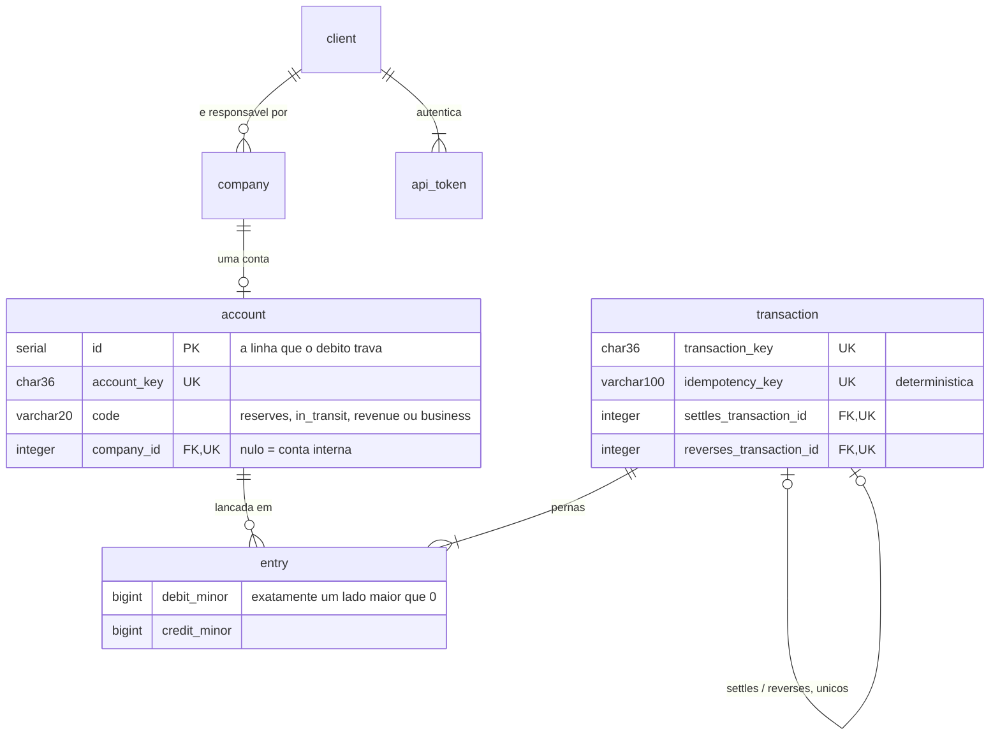
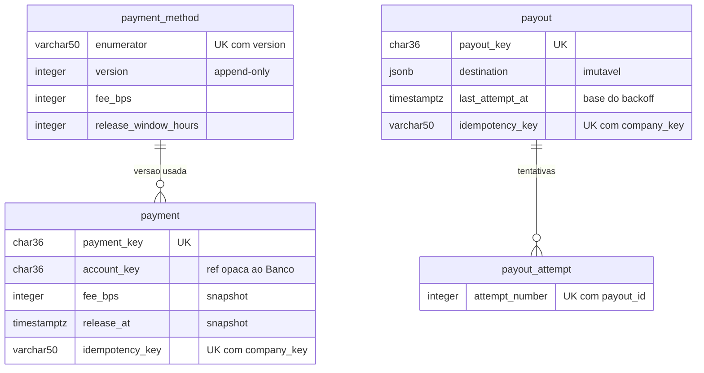
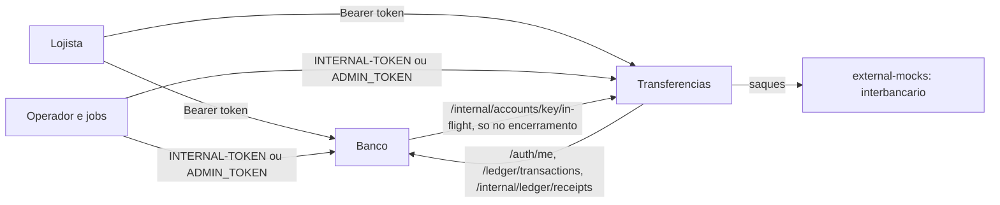

# RFC — Conta PJ com gateway de pagamento (RNV)

| | |
|---|---|
| **Time** | Ramon Guimarães Cruz · Victoria Camile Bertuchi · Natalia Lugão |
| **Data** | 12/10/2026 |
| **Versão** | 8.0 — o que a implementação decidiu (substitui a 7.2 apresentada na defesa) |

## 1. Visão geral

Somos uma **instituição de pagamento** para pequenas empresas. O lojista abre conta conosco e recebe vendas pelo nosso gateway (pix, boleto, cartão). Não oferecemos crédito: só guardamos e movimentamos dinheiro de terceiros. **Só é cliente do gateway quem tem conta conosco.** O dinheiro entra pelo gateway, fica retido por uma janela, é liberado na conta do lojista com a taxa descontada, e sai quando o lojista pede (saque, pagamento de boleto ou transferência para fora do banco).

O sistema existe para dar quatro garantias:

- **O livro sempre fecha:** em toda transação, soma dos débitos = soma dos créditos, inclusive quando o dinheiro vem de fora ou vai para fora.
- **O saldo nunca diverge nem fica negativo:** é derivado do livro imutável, e o débito só acontece com saldo conferido sob trava.
- **Nada acontece duas vezes:** um pedido repetido não move dinheiro de novo, e cada venda tem uma saída só (liberada **ou** estornada).
- **Tudo é auditável:** a taxa aplicada e o destino de cada saída ficam gravados no registro da operação e não mudam depois; a equação do livro é consultável a qualquer momento.

**Fora do escopo:** crédito, câmbio, conta em outro banco como entidade gerenciada, movimentação entre clientes sem o dinheiro sair do banco, e a integração real com o interbancário e com o birô (os dois são simulados).

**Arquitetura.** Dois serviços de negócio síncronos, cada um com seu banco de dados, e um simulador de sistemas externos:

| Serviço | Papel | Dono de |
|---|---|---|
| **Banco** | motor do livro e da identidade | `client`, `company`, `account`, `api_token`, `transaction`, `entry` |
| **Transferências** | borda do produto | `payment`, `payout`, `payout_attempt`, tarifas e janelas, os jobs de liberação e reconciliação |
| **external-mocks** | simula o interbancário | nada persistente: estado em memória |

O Transferências decide *o quê* lançar e chama o Banco; o Banco executa os lançamentos, garante que fecham, deduplica pela chave e confere o saldo sob trava. **O dinheiro tem um dono só**: nenhuma operação escreve nos dois bancos de dados, então não existe transação distribuída. Entre os serviços só trafega a chave pública (UUID), nunca `id` interno nem FK.

A **identidade** segue a mesma regra. O token nasce no Banco (`POST /clients`); o Transferências não guarda cliente nenhum e valida cada requisição chamando `GET /auth/me` no Banco, que devolve o `client_key` e as empresas com suas contas.

As chamadas entre serviços usam `INTERNAL-TOKEN` e vão quase todas do Transferências para o Banco. **Há uma exceção, consciente:** para encerrar uma conta, o Banco pergunta ao Transferências se há valores em trânsito (seção 5.5).

**O payout é sempre uma saída do dinheiro para fora do banco.** Saque, pagamento de boleto e transferência são rótulos do mesmo fluxo, com um `destination` externo que nunca muda depois de gravado. Como a saída pode falhar, o lançamento nasce `pending` e, se o repasse falhar, é desfeito por uma `reversal` (seção 5.4).

**As contas do livro.** O livro fecha porque toda entrada e saída tem contrapartida numa conta do próprio banco:

| Conta (`code`) | Classe | O que guarda |
|---|---|---|
| Caixa (`reserves`) | ATIVO | o dinheiro que o banco de fato tem |
| Trânsito (`in_transit`) | PASSIVO | recebido e ainda na janela, ou pedido e ainda não saído |
| Receita (`revenue`) | RECEITA | as taxas cobradas |
| Cliente (`business`, uma por empresa) | PASSIVO | o que o banco deve a cada lojista |

A equação que vale a qualquer instante: **TEM = DEVE + GANHOU** (Caixa = Trânsito + Clientes + Receita). O `GET /admin/internal-accounts` devolve os quatro totais e `equation_ok`.

## 2. Fluxo ponta a ponta

Um pix de **R$ 1.000,00** com a taxa real do pix (0,99%, `fee_bps = 99`, janela de 24 h), do cadastro até a conta ser encerrada. Valores em reais para leitura; no banco tudo é centavo inteiro.

| # | Endpoint (serviço) | Quem dispara | O que nasce | Lançamentos |
|---|---|---|---|---|
| 1 | `POST /clients` (Banco) | o responsável, sem token | `client` + `api_token` (devolvido uma vez) | — |
| 2 | `POST /companies` e `POST /companies/{key}/accounts` (Banco) | o responsável, com token | `company`; `account` do cliente, que nasce `active` se o **birô aprovar a empresa** ou `rejected` se reprovar. O birô é consultado uma vez, na abertura | — |
| 3 | `POST /payments` + `Idempotency-Key` (Transferências → Banco) | o site do lojista | `payment` **held**, com `fee_bps` e `release_at` **snapshotados** da versão vigente do meio de pagamento; `transaction` **receipt** | D Caixa 1.000,00 · C Trânsito 1.000,00 |
| 4 | — | o relógio | nada. O lojista vê R$ 1.000,00 "a receber", que **ainda não é saldo** | — |
| 5 | `POST /internal/settlements` (Transferências → Banco) | job, quando `release_at` vence | `transaction` **settlement**; `payment → settled` | D Trânsito 990,10 · D Trânsito 9,90 · C Cliente 990,10 · C Receita 9,90 |
| 6 | `POST /payouts` + `Idempotency-Key` (Transferências → Banco) | o lojista, com finalidade e destino | `transaction` **payout**, `pending` (saldo conferido sob trava); `payout` **pending** com o destino gravado | D Cliente 990,10 · C Trânsito 990,10 |
| 7 | `POST /internal/payouts/reconcile` (Transferências → interbancário → Banco) | job; o interbancário confirma | `payout_attempt` `confirmed`; `transaction` **settlement**; a `payout` vai `pending → settled`; `payout → settled` | D Trânsito 990,10 · C Caixa 990,10 |
| 8 | `POST /accounts/{key}/close` (Banco → Transferências) | o responsável | o Banco confere saldo zero e pergunta ao Transferências se há algo em trânsito; `account → closed` | — |

**O livro fechando em cada passo:**

| Depois do | Caixa (TEM) | Trânsito | Cliente | Receita | Equação |
|---|---|---|---|---|---|
| 3 | 1.000,00 | 1.000,00 | 0 | 0 | 1.000,00 = 1.000,00 |
| 5 | 1.000,00 | 0 | 990,10 | 9,90 | 1.000,00 = 990,10 + 9,90 |
| 6 | 1.000,00 | 990,10 | 0 | 9,90 | 1.000,00 = 990,10 + 9,90 |
| 7 | 9,90 | 0 | 0 | 9,90 | 9,90 = 9,90 |

No fim, o banco tem em caixa exatamente o que ganhou. O resto entrou e saiu. Uma história equivalente, com vendas nos três meios, estorno e saque recusado, roda de forma executável na coleção [`rnv-ponta-a-ponta.postman_collection.json`](postman/rnv-ponta-a-ponta.postman_collection.json), que confere os saldos e a equação do livro a cada passo.

**Caminhos alternativos:**

- **Estorno dentro da janela** (`POST /payments/{key}/refund`): nasce uma `transaction` **refund** com `reverses_transaction_id` apontando para a `receipt`. Lançamentos: D Trânsito 1.000,00 · C Caixa 1.000,00, **valor cheio**, porque a taxa ainda não foi cobrada. `payment → refunded`. Quem decide é o **status**, não o relógio: enquanto o job não liberou, o payment segue `held` e o estorno passa, mesmo com `release_at` vencido. Depois de `settled`, o estorno é recusado (`409 RNV001026`).
- **Saldo insuficiente no passo 6:** o Banco recusa (`422 RNV001006`), o Transferências repassa o erro, nenhuma linha é gravada e a chave do cliente fica livre.
- **Recusa definitiva do interbancário no passo 7:** `payout → failed` na hora, com uma `transaction` **reversal** apontando para a `payout`: D Trânsito 990,10 · C Cliente 990,10. O dinheiro volta para a conta do lojista.
- **Interbancário sem resposta no passo 7:** a reconciliação retenta com espera crescente (60 s, depois 120 s). Na **3ª tentativa sem resposta**, `failed` + reversal, como na recusa (seção 5.4).
- **Encerramento com algo em trânsito no passo 8:** se houver venda `held` ou saque `pending`, o encerramento é recusado (`422 RNV001035`), mesmo com saldo zero.

## 3. Modelo de dados

Um PostgreSQL por serviço, sem FK nem join entre eles: o Transferências guarda as chaves públicas do Banco (`company_key`, `account_key`, `transaction_key`) como valores opacos. Dinheiro é `BIGINT` em centavos, datas são `TIMESTAMPTZ`, enumeradores são tabelas de lookup e o `id` interno nunca sai na resposta. Os diagramas abaixo mostram só as entidades centrais e as colunas que carregam regra; todas as tabelas e colunas, restrições e índices estão em [`modelo-de-dados.md`](modelo-de-dados.md).





A `entry` é append-only e não tem `balance_after`: o saldo sai de `SUM(credit_minor) − SUM(debit_minor)` pelo índice `(account_id, id) INCLUDE (debit_minor, credit_minor)`. Uma transação não pode debitar e creditar a mesma conta (`422 RNV001037`).

## 4. Rotas e autorização

O contrato de cada rota (o que recebe, devolve e quais erros pode dar) está em [`rotas.md`](rotas.md); os códigos de erro, em [`catalogo-de-erros.md`](catalogo-de-erros.md); o simulador interbancário, em [`mocks-externos.md`](mocks-externos.md). Aqui fica só quem conversa com quem e como cada rota autoriza:



**Quatro acessos.** Público (`/`, `/health_check`, `POST /clients`); cliente (`Authorization: Bearer <token>`, `401 RNV000003` se faltar ou for inválido); serviço (`/internal/*`, `/ledger/*`, `/auth/*` com `INTERNAL-TOKEN`, `403 RNV000002`); admin (`/admin/*` com o token de administrador da env `ADMIN_TOKEN`; token de cliente recebe `403 RNV001027`).

**O token autentica; cada rota autoriza.** Recurso de outro dono responde `404`, igual ao inexistente, para não confirmar que existe. Além disso:

| Rota | Exige | Se faltar |
|---|---|---|
| `POST /companies/{key}/accounts` | empresa do próprio cliente, ainda sem conta | `404 RNV001018` / `409 RNV001022` |
| `POST /payments` | empresa do cliente | `404 RNV001018` |
| `POST /payments` | empresa com conta aberta | `403 RNV001030` |
| `POST /payments`, `POST /payouts` | conta `active` | `403 RNV001031` |
| `POST /payouts` | conta de uma empresa do cliente | `404 RNV001018` |
| saldo, extrato, consultas | só a posse; **leitura passa com a conta `blocked` ou `closed`** | `404 RNV001021` |

O birô valida a empresa **uma vez, na abertura da conta**. A reprovação não tem código próprio: a conta nasce `rejected`, que é um estado "não active" e cai em `RNV001031` na escrita. Uma empresa reprovada não reabre conta.

**Erros e paginação.** Todo erro tem o formato `{title, description, translation, code}`, com código estável que identifica o erro, não o serviço: um saldo insuficiente detectado pelo Banco chega ao lojista pelo Transferências com o mesmo `RNV001006`. As listas usam keyset do mais novo para o mais antigo com cursor opaco assinado (HMAC), para que o `id` interno nunca saia em claro.

## 5. Desafios

### 5.1 Controle de saldo sob concorrência

**O problema:** dois débitos simultâneos leem o mesmo saldo, os dois passam na conferência, e o lojista saca duas vezes um dinheiro que só tinha uma vez (*lost update*).

**Como resolvemos:**

1. **O saldo é derivado:** `SUM(credit_minor) − SUM(debit_minor)` nas `entry` da conta, nunca armazenado. É uma função pura do livro imutável. Isso **elimina o *lost update*** no valor guardado; não elimina a necessidade do lock.
2. **O lock existe, no caminho do débito, na linha da `account`.** Não dá para travar a `entry`: ela é append-only e o `INSERT` novo não tem linha para travar. A linha da conta é o portão: existe sempre, é uma por conta, identidade estável.
3. **Ordem:** travar **antes** de somar.

```sql
BEGIN;
SELECT id FROM account WHERE account_key = :k FOR UPDATE;
SELECT COALESCE(SUM(credit_minor) - SUM(debit_minor), 0) FROM entry WHERE account_id = :id;
-- saldo < valor: ROLLBACK e 422, nenhuma linha gravada
INSERT INTO transaction ...; INSERT INTO entry ...;
COMMIT;
```

4. **Duas contas de cliente na mesma operação:** travar sempre na ordem do **id menor primeiro**. Nenhum fluxo desta versão debita duas contas de cliente, mas a regra fica fixada para evitar *deadlock* quando existir movimentação entre clientes.
5. **Crédito não trava**, e **conta interna nunca é travada**: travar o Trânsito ou o Caixa serializaria o sistema inteiro.
6. **Isolamento READ COMMITTED** (o padrão do Postgres). O `SUM` executado **depois** da trava enxerga o débito que o pedido anterior acabou de commitar. Em REPEATABLE READ a foto seria a do começo da transação e o bug voltaria.
7. **Outras linhas que servem de portão:** a linha do `payment` (estorno × liberação), a do `payout` (rodadas simultâneas da reconciliação), a da `transaction` referenciada (duas liquidações da mesma venda) e a da última versão do `payment_method` (duas mudanças de taxa ao mesmo tempo). Os `UNIQUE` (`settles_transaction_id`, `reverses_transaction_id`, `(payout_id, attempt_number)`, `account.company_id`) são a rede de proteção atrás de cada trava.

**Perguntas de estresse:**

- *Mil débitos simultâneos na mesma conta?* Fazem fila na linha da conta, um por vez, cada um vendo o saldo real. Mais lento para aquela conta, nunca errado. Contas diferentes seguem em paralelo.
- *Um cliente com um milhão de lançamentos?* O `SUM` é O(n) por conta, mas o índice com os valores incluídos resolve sem ler a tabela. Se precisar, a evolução é um saldo materializado numa linha **mutável**, atualizado na mesma transação com `UPDATE ... SET saldo = saldo + :delta WHERE saldo + :delta >= 0`, sempre reconstruível a partir da `entry`.
- *E as contas internas, que crescem com o sistema inteiro?* Não estão no caminho de nenhuma requisição de cliente. A conferência é a equação do livro, consultada pelo admin.

### 5.2 Idempotência

**A semântica:** a chave é do **cliente**, e o banco **não adivinha intenção**. Mesma chave = "estou tentando de novo, me diz o que aconteceu". Chave nova = operação nova. Mesma chave com conteúdo diferente = `422 RNV001024`. Ela existe para falha de comunicação, não para detectar uma compra parecida. A chave nunca expira.

**O header `Idempotency-Key` é obrigatório** em `POST /payments` e `POST /payouts` (1 a 50 caracteres; ausente ou fora do tamanho, `400 RNV000012`). Não existe operação de dinheiro sem chave.

**O mecanismo: a chave mora na própria entidade.** O `payment` e o `payout` guardam `idempotency_key` e `payload_hash` (SHA-256 do JSON canônico dos campos que definem o pedido; a ordem das chaves não importa), com `UNIQUE(company_key, idempotency_key)`. A `transaction` do Banco funciona igual. Não existe tabela de idempotência genérica nem resposta gravada.

1. O `INSERT` da entidade, já com a chave e o hash, é a **primeira escrita** da operação.
2. **Gravou:** é pedido novo. A operação segue e responde `201`.
3. **O `UNIQUE` recusou:** é repetição. *Rollback*, busca da linha pela chave e comparação do `payload_hash`: igual devolve a entidade como ela está **agora**, com `200`; diferente, `422 RNV001024`.
4. **A resposta do retry é o estado atual, não uma foto.** Um saque que já foi liquidado volta `settled` com `200`, e não `pending` com `201`.
5. **Erro não fica guardado.** Se a operação falha (saldo insuficiente, Banco fora), o *rollback* desfaz também o `INSERT`, e a chave fica livre.
6. **O estorno não tem chave.** A idempotência vem da máquina de estados: `held → refunded` é mão única, e um estorno repetido recebe `409 RNV001003`, sem novo lançamento.

**As chaves dos lançamentos no Banco** são sempre determinísticas, para que uma repetição reencontre o lançamento em vez de criar outro:

- **Disparados pelo cliente**, derivados da chave dele: `receipt:<company_key>:<chave>` e `payout:<company_key>:<chave>`. Se o Transferências cair depois de o Banco lançar e antes de commitar, o retry chega ao Banco com a mesma chave e recebe o lançamento existente.
- **Disparados por job ou estorno**, derivados da entidade: `settlement:<payment_key>`, `refund:<payment_key>`, `settlement:<payout_key>` e `reversal:<payout_key>`.

**Tamanhos coordenados.** A chave do cliente tem no máximo **50 caracteres** porque vira parte de uma chave composta no Banco. O maior composto é `receipt:<company_key>:<chave>`: 8 + 36 + 1 + 50 = **95 caracteres**, e a coluna do livro tem **100**.

**Perguntas de estresse:**

- *A mesma chave dez vezes ao mesmo tempo?* O primeiro `INSERT` ocupa a chave no índice único; os outros nove esperam, recebem o conflito e leem a entidade. **Uma** operação acontece.
- *O primeiro pedido falha no meio?* O *rollback* libera a chave. Quem estava esperando grava normalmente.
- *O Banco lançou, mas a resposta se perdeu?* O Transferências responde `503 RNV001017`, que significa "resultado desconhecido, retente com a mesma chave". O retry reencontra o lançamento. Se o cliente nunca retentar, sobra um recebimento sem venda, que a reconciliação estorna depois de uma carência (seção 5.4).

### 5.3 Taxa, janela e arredondamento

- **A taxa é dado, não código.** A tabela `payment_method` tem, por meio de pagamento, `fee_bps` e a janela: pix 0,99% em 24 h, boleto 1,99% em 72 h, cartão 4,99% em 720 h. Pix e boleto são irreversíveis, o cartão tem *chargeback*: risco diferente justifica taxa e janela diferentes.
- **A taxa é versionada e append-only.** `PUT /internal/payment-methods/{method}` grava uma **linha nova** com `version + 1`; valores iguais aos atuais respondem `200` sem gravar. Nunca há `UPDATE`. Mudanças simultâneas no mesmo método são serializadas pela trava na versão atual.
- **Snapshot na chegada.** O `payment` aponta para a versão usada e copia `fee_bps` e `release_at`. O *settle* usa só o snapshot. Mudar a taxa nunca altera o que já foi vendido: cobra-se a taxa informada ao cliente na venda, e dá para provar qual foi.
- **Cobrada na liberação.** Durante a janela o dinheiro fica retido **cheio** no Trânsito, porque um estorno devolve o valor integral.
- **Centavo inteiro e aritmética inteira, nunca *float* nem `round()`.** `fee = (amount_minor × fee_bps + 9999) // 10000` e `net = amount_minor − fee`. A taxa arredonda **para cima** e o centavo residual fica com o cliente. **Invariante:** `fee + net = amount_minor`, exato. Pernas de valor zero são omitidas do lançamento (o livro exige ao menos 1 centavo por perna).

### 5.4 A saída do dinheiro: reconciliação do payout

O `POST /payouts` só debita a conta e grava o pedido. Quem leva o dinheiro para fora é o job `POST /internal/payouts/reconcile`, que chama o interbancário para cada payout `pending`.

**A fase é derivada, nunca guardada.** O que fazer com um payout sai da última `payout_attempt` e do número de tentativas (`COUNT`), não de um campo mutável:

| Estado derivado | Fase | O que faz |
|---|---|---|
| nenhuma tentativa, ou último `timeout` com menos de 3 e espera vencida | tentar | chama o interbancário e grava a `payout_attempt` antes de qualquer lançamento |
| último `confirmed` | liquidar | `settlement:<payout_key>` (D Trânsito / C Caixa); `payout → settled` |
| último `rejected`, ou 3 tentativas terminando em `timeout` | desfazer | `reversal:<payout_key>` (D Trânsito / C Cliente); `payout → failed` com o motivo |

- **`failed` só existe junto da reversal.** Se o Banco recusar a reversal (conta bloqueada) ou estiver fora, o payout continua `pending` e o próximo run repete só a reversal, sem chamar o interbancário de novo. Nunca há saque falho sem o dinheiro de volta.
- **Retentativa com espera crescente:** 60 s após a 1ª tentativa, 120 s após a 2ª, limite de 3 (configuração). Classificação do interbancário: `200` é confirmado, `422 refused` é recusa definitiva, e qualquer outra coisa (timeout de 5 s, erro de conexão, `5xx`) é timeout, o caminho seguro para o dinheiro do lojista.
- **Teto por run:** no máximo 50 payouts por chamada; o resto fica para o próximo.
- **Concorrência:** cada payout é tratado em transação própria, com a linha travada e o status relido. Dois runs simultâneos não fazem tentativa dupla nem lançamento dobrado.

**Recebimento sem venda.** Se o Banco lançou o `receipt`, a resposta se perdeu e o cliente nunca retentou, o valor fica no Trânsito sem `payment`. O job `POST /internal/receipts/reconcile` lista no Banco os recebimentos em aberto criados antes de uma carência (24 h, configuração), descarta os que têm `payment` e estorna os demais (`refund`, chave `orphan-refund:<transaction_key>`, valor cheio). Não dá para criar a venda depois, porque o livro não guarda o meio de pagamento. Como a chave do cliente nunca expira, um retry tardio poderia criar uma venda sobre um recebimento já estornado: o Banco sinaliza `reversed` no replay e o `POST /payments` recusa com `409 RNV001038`.

**O relógio dos jobs.** Os dois jobs aceitam no corpo um `as_of` opcional (ISO 8601 com fuso) que substitui o "agora". Ele existe para testar sem esperar a janela de 24 h a 720 h nem o backoff, só com `INTERNAL-TOKEN` e nunca em rota de cliente. Em operação, sem `as_of`, vale o relógio do servidor e o prazo das tabelas.

### 5.5 Encerramento e bloqueio da conta

**Encerrar exige nada pendente.** `POST /accounts/{key}/close` só encerra com **saldo zero e nada em trânsito**: nenhuma venda `held` e nenhum saque `pending` daquela conta. Saldo zero não basta, porque uma venda na janela ainda vai creditar a conta, e um saque pendente pode voltar por reversal.

Quem sabe o que está em trânsito é o Transferências. Por isso o Banco, ao encerrar, chama `GET /internal/accounts/{key}/in-flight`. É a **única** chamada do Banco para o Transferências, e é deliberada: a alternativa seria duplicar no Banco o estado do produto, quebrando a regra de um dono só.

- **Ordem:** trava a linha da conta, confere o status, confere o saldo (lido depois da trava), consulta o in-flight, muda o status, commit. Débitos concorrentes na mesma conta esperam e, ao entrar, enxergam a conta `closed`.
- **Fail-closed:** se o Transferências não responder, o Banco recusa (`503 RNV001036`) e a conta continua `active`. Nunca fecha na dúvida.

**Bloquear não move dinheiro.** `POST /internal/accounts/{key}/block` (serviço) congela a escrita: novas vendas e saques são recusados, e o livro recusa lançar na conta. O saldo continua na conta do titular, como passivo do banco perante ele, e a leitura (saldo, extrato) continua liberada. Para fundos bloqueados por fraude ou ordem judicial, mover o dinheiro para uma conta interna própria é evolução.

### 5.6 Limites de valor

Todo valor tem teto validado por JSON Schema na entrada, para que um valor extremo vire `400` ou `422` e nunca um `500`: valores até o teto do `BIGINT`, de 2 a 20 pernas por lançamento, `destination` até 4096 bytes, `fee_bps` até 10000 e janela até 8760 h. A tabela completa está em [`rotas.md`](rotas.md).

## 6. Tradeoffs e alternativas descartadas

- **Coluna `balance_after` na `entry`** — descartada. É um valor dependente de ordem, calculado por *read-modify-write* e gravado numa linha imutável: um *lost update* fica cravado no livro para sempre.
- **Saga, fila ou processamento assíncrono** — descartados conscientemente. Síncrono com idempotência, porque corretude do saldo vale mais que vazão.
- **Banco consultando o Transferências no encerramento** — aceito, como única exceção à direção das chamadas. Duplicar no Banco o estado das vendas e saques seria pior que uma chamada fail-closed numa operação rara.
- **Cliente com conta em outro banco** — descartado. Era complexidade sem ganho conceitual; a saída do dinheiro existe, com o destino dado na requisição.
- **`failed` no status do livro** — descartado. No livro, ou o dinheiro se moveu, ou o movimento foi desfeito por uma transação nova (`refund` para o recebimento, `reversal` para o payout). O estorno não muda o status do original. O `failed` existe só no `payout_status`.
- **Duas colunas (`debit_minor`/`credit_minor`) em vez de um `amount` com sinal** — mantidas. O `CHECK` garante exatamente uma preenchida e nenhuma negativa.
- **Tabela de idempotência genérica** — descartada em favor da chave na própria entidade. O custo é o retry refletir o estado atual em vez de uma foto da resposta.
- **`retry_count` no `payout`** — descartado. O número de tentativas já está nas linhas de `payout_attempt`; um contador mutável poderia divergir.

## 7. Riscos aceitos e limites conhecidos

O detalhamento, com números e caminho de evolução, está em [`limites-e-evolucao.md`](limites-e-evolucao.md). Os principais:

| Risco | Efeito | Mitigação hoje | Evolução |
|---|---|---|---|
| **Recebimento sem venda: resíduo.** Um retry tardio pega o replay antes do estorno da reconciliação e grava o `payment` depois da checagem do job | um `payment` `held` sobre um recebimento estornado, que não libera nem estorna; o livro fecha | carência de 24 h, `reversed` no replay e `409 RNV001038` cobrem todo o resto; a janela é de milissegundos | trava comum (advisory lock por empresa + chave) entre o job e o `POST /payments` |
| **Interbancário pagou e a resposta se perdeu** | daríamos `failed` e devolveríamos um dinheiro que saiu | o simulador não perde respostas | consultar o status no destino antes do `failed` por timeout |
| **Conexão presa durante chamada HTTP** | o `payment` e o reconcile seguram conexão e trava enquanto esperam o Banco ou o interbancário (até 5 s) | timeouts curtos e pool que falha rápido (`503 RNV000006`) | gravar estado intermediário, commitar, e só então chamar |
| **Venda aceita durante o encerramento** | uma venda iniciada antes do commit do `close` pode não aparecer no in-flight; a liberação depois é recusada e ela fica `held` até um estorno | o guard de conta `active` barra quem chega depois | o Transferências travar algo da conta no `POST /payments` |
| **Saque `pending` com conta bloqueada** | a reversal é recusada e o saque fica parado até o desbloqueio | o run o reporta em `pending` | alerta e limite de idade |
| **Jobs sem agendador** | liberação e reconciliação dependem de alguém chamar a rota | `as_of` para testar | agendador e fatiamento por empresa |

## 8. Problemas apontados na defesa da v7.2

| O que os leads apontaram | O que mudou |
|---|---|
| *Lost update* no `balance_after` (bloqueador) | Saldo derivado da `entry` + `FOR UPDATE` na linha da `account`, só no débito, em READ COMMITTED |
| "Como vocês vão travar a `entry`?" | Não se trava a `entry`, trava-se a conta, que é o recurso disputado |
| "O livro de vocês não fecha em zero" | Fecha. Faltava a conta de ATIVO (Caixa); o fluxo da seção 2 mostra o livro fechando em cada passo |
| Fluxo ponta a ponta (pedido cinco vezes) | Abre a RFC: endpoint, gatilho, entidade e lançamentos por passo |
| O `PUT` da conta externa apaga o histórico | A conta externa saiu. O destino de cada saída fica gravado no `payout` e não muda |
| `failed` no livro não faz sentido | Saiu. O livro desfaz com uma transação nova: `refund` ou `reversal` |
| Micro-centavos da taxa | Arredondamento para cima, com o invariante `fee + net = amount` |
| "A taxa é feature ou tabela?" | Tabela por meio de pagamento, com snapshot no `payment` |
| Birô validando a cada etapa | Valida a empresa uma vez, na abertura da conta |
